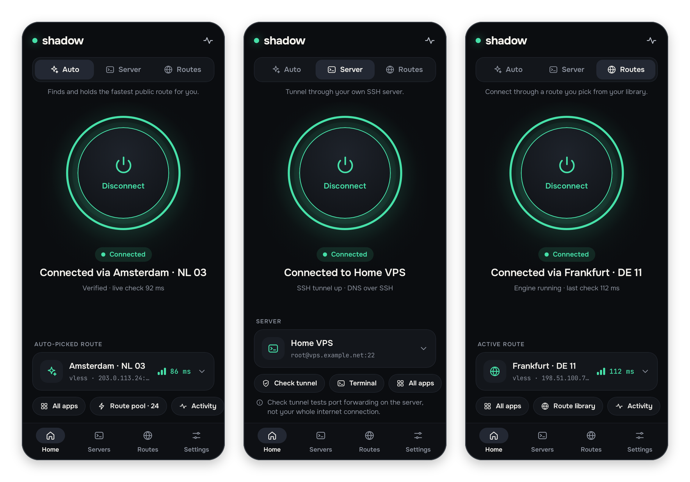
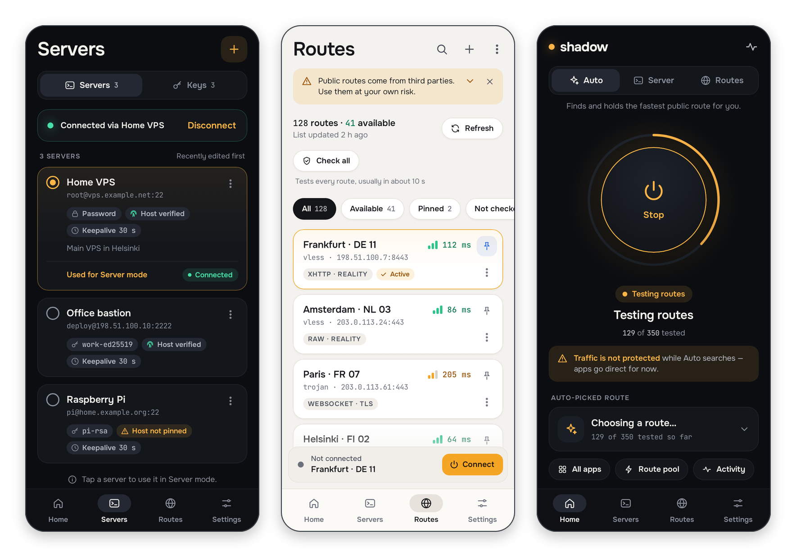
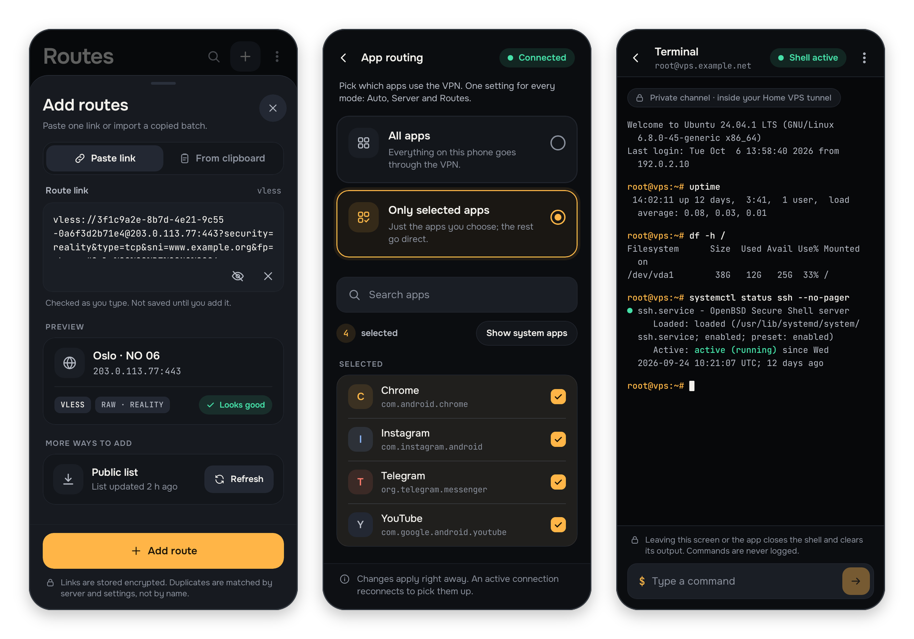
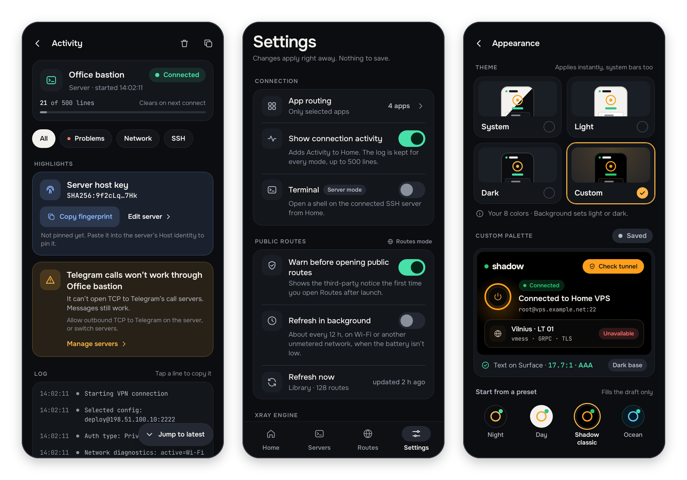
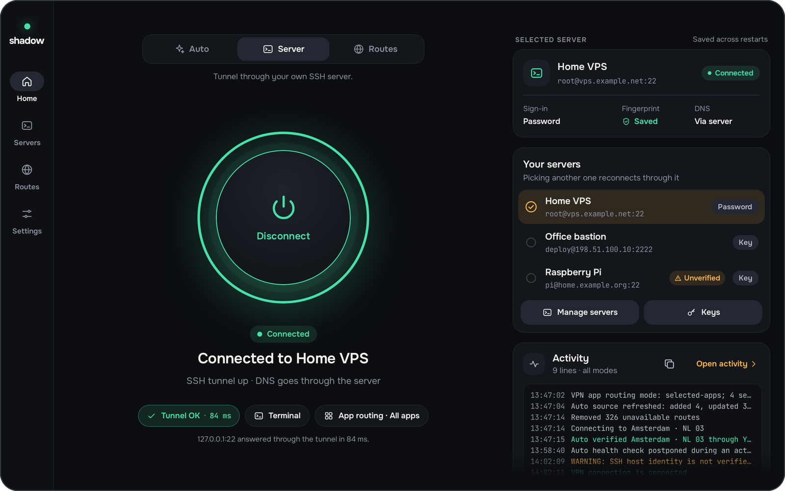

# shadow

**VPN-клиент для Android: свой SSH-сервер, маршруты Xray и автоподбор**

**Android VPN client: your own SSH server, Xray routes and automatic route selection**

[](https://github.com/stansful/ssh-vpn-client-kotlin/releases/latest)


[Русский](#русский) · [English](#english)

> [!IMPORTANT]
> **Это приложение — проверка того, могут ли современные нейросети создавать приложения с минимальным участием разработчика. Ответ — да.**
> Код писали нейросети. Разработчик ставил задачи обычными словами, запускал сборку и проверял результат на телефоне. Подробнее — в разделе [«Как это сделано»](#как-это-сделано).
>
> **This app is a test of whether today's neural networks can build applications with minimal developer involvement. The answer is yes.**
> The code was written by neural networks. The developer described tasks in plain language, ran the builds and checked the result on a phone. More in [How it was made](#how-it-was-made).



## Русский

**shadow** — VPN-клиент для Android 8.0 и новее. Он пропускает трафик телефона через туннель в одном из трёх режимов:

| Режим | Как работает |
|---|---|
| **Server** | Туннель через ваш собственный SSH-сервер. Ставить на сервер ничего не нужно: хватит обычного SSH-доступа по паролю или ключу, если на сервере разрешён проброс портов (в OpenSSH он разрешён по умолчанию). |
| **Routes** | Подключение через маршрут из вашей библиотеки — свою ссылку или маршрут из публичного списка: VLESS, VMess, Trojan или Hysteria 2 на движке Xray. |
| **Auto** | Приложение само находит самый быстрый рабочий публичный маршрут, держит соединение и переключается на другой маршрут, если текущий перестаёт отвечать. |

### Возможности

- 🔑 **Серверы и ключи.** Вход по паролю или ключу (OpenSSH или RSA PEM, можно с парольной фразой). Один ключ подходит для нескольких серверов. Если сохранить отпечаток хоста, он проверяется до отправки пароля или ключа (скопировать отпечаток можно в Activity после первого подключения).
- 🔄 **Переподключение.** Keepalive и автоматическое восстановление после обрыва или смены сети.
- 🌐 **DNS через туннель.** В режиме Server DNS-запросы идут через SSH-сервер.
- 📚 **Библиотека маршрутов.** Вставка ссылки или целой пачки ссылок из буфера обмена, загрузка публичного списка, проверка всех маршрутов (обычно около 10 секунд), закрепление, поиск и фильтры.
- 📱 **Выбор приложений.** Через VPN идут все приложения или только выбранные. Настройка общая для всех режимов.
- 💻 **SSH-терминал.** Командная строка подключённого сервера прямо в приложении (включается в настройках).
- 🩺 **Журнал подключения.** Экран Activity с фильтрами и подсказками. Пароли, ключи и команды терминала туда не попадают.
- ⚡ **Плитка в шторке.** Одно касание запускает последний использованный режим или отключает VPN.
- 🎨 **Темы.** Системная, светлая, тёмная или своя палитра из 8 цветов.
- ⬆️ **Обновления.** При запуске приложение проверяет GitHub Releases (не чаще раза в сутки), докачивает прерванную загрузку и перед установкой сверяет имя пакета, версию и подпись.
- 🔒 **Хранение секретов.** Пароли, ключи и ссылки маршрутов зашифрованы (Tink, ключ шифрования — в Android Keystore) и не попадают в резервные копии.
- 🖥️ **Планшеты.** Боковая навигация и двухпанельные экраны.

### Скриншоты



*Свои SSH-серверы · Библиотека маршрутов (светлая тема) · Auto ищет самый быстрый маршрут*



*Добавление маршрута по ссылке · Выбор приложений для VPN · SSH-терминал*



*Журнал подключения · Настройки · Темы и своя палитра*



*Интерфейс для планшетов*

### Установка

1. Скачайте `app-universal-release-<версия>.apk` из [последнего релиза](https://github.com/stansful/ssh-vpn-client-kotlin/releases/latest). Большинству современных телефонов подойдёт и `app-arm64-v8a-release-<версия>.apk`.
2. Откройте файл и установите приложение. Android попросит разрешить установку из этого источника.
3. Настройте нужный режим:
   - **Server** — добавьте свой сервер на вкладке **Servers** (кнопка **+**);
   - **Auto** — один раз скачайте движок Xray: кнопка **Download engine** на главном экране или **Settings → Xray engine**;
   - **Routes** — тот же движок и хотя бы один маршрут: на вкладке **Routes** нажмите **Fetch public list** или **Add from a link** и выберите маршрут.
4. Выберите режим вверху главного экрана, нажмите большую кнопку и разрешите приложению создать VPN.

Приложение само находит новые версии и предлагает их установить. Интерфейс приложения — на английском языке.

### Что важно знать

- В режиме Server через SSH идут TCP и DNS. Остальной UDP-трафик (QUIC, игры, звонки в других мессенджерах) SSH не передаёт — это ограничение протокола. Исключение — звонки в Telegram: они работают и через SSH, если сервер может открыть TCP-соединение с серверами звонков Telegram (если не может, Activity об этом скажет). В режимах Routes и Auto UDP-трафик проходит.
- Публичные маршруты принадлежат третьим лицам — используйте их на свой риск. Пока Auto ищет или меняет маршрут, трафик идёт мимо VPN. Если это важно, включите в настройках VPN на Android параметр «Блокировать соединения без VPN».

### Сборка из исходников

Нужны macOS или Linux, JDK 17+ и Android SDK с API 37. Путь к SDK берётся из `ANDROID_HOME` или из `local.properties` (пример — [local.properties.example](local.properties.example)).

```bash
./scripts/check-env.sh      # проверить JDK, SDK и Gradle
./scripts/build-debug.sh    # собрать debug APK
./scripts/install-debug.sh  # установить на подключённое устройство
./scripts/test.sh           # запустить юнит-тесты
```

- **Релиз:** `./scripts/build-release.sh`. Если переменные `SSH_VPN_RELEASE_*` не заданы, скрипт сам создаст локальный ключ подписи в `.local/signing/`. Кроме APK, скрипт собирает движок Xray для релиза: нужны `ANDROID_HOME` в окружении (одного `local.properties` мало) и python3, а без готового `app/libs/libXray.aar` — ещё Go и Android NDK. Чтобы пропустить этот шаг, задайте `SSH_VPN_SKIP_XRAY_RELEASE_ASSETS=1`.
- **Публикация:** GitHub Actions собирает и публикует релиз, когда в `master` меняется версия в `app/build.gradle.kts`.
- **Скриншоты** отрендерены из Compose-кода без эмулятора: `./scripts/screenshots.sh` кладёт рендеры в `app/build/screenshots/`, а `python3 scripts/readme-screenshots.py` (нужен Pillow) собирает из них картинки для README в `docs/screenshots/`.

### Как это сделано

Разработчик не писал код сам. Он описывал задачи простыми фразами — «добавь кнопку подключения», «перекрась», «вот это сломалось», «добавь логи для отладки», «нужна новая функция» — запускал сборку и проверял результат на телефоне. Первые версии сделал Codex в связке с ChatGPT-5.5. На них ушло около 6 часов, из которых примерно 4 — просмотр YouTube.

С тех пор проект развивается так же. Сейчас в нём около 63 000 строк Kotlin, больше 600 юнит-тестов и CI для релизов. Ход работы по шагам записан в [docs/WORKLOG.md](docs/WORKLOG.md).

Промт, с которого всё началось:

```text
Твоя задача помочь мне в написании тз для вайбкодинга =)
Я хочу написать приложения для андройда,
суть приложения в том что оно создаёт vpn соединение используя стандартный ssh протокол
для mvp достаточно только ssh соединения с массивом соединений
а также выбором/добавлением конфигураций - основные параметры ssh соединения:
адрес порт пользователь закрытый ключ / пароль отпечаток keepalive udp-переадресация примечание(оно будет текcтом на ui)
```

### Документация

| Документ | О чём |
|---|---|
| [docs/TECHNICAL_DOCUMENTATION.md](docs/TECHNICAL_DOCUMENTATION.md) | Архитектура, VPN, Xray, хранение данных, сборка, безопасность |
| [README_SA.md](README_SA.md) | Описание для системного аналитика: участники, сценарии, состояния |
| [docs/DESIGN_FUNCTIONAL_SPEC.md](docs/DESIGN_FUNCTIONAL_SPEC.md) | Все экраны, состояния и тексты версии 3.4.0, до редизайна (исходные данные для него) |
| [docs/WORKLOG.md](docs/WORKLOG.md) | Журнал разработки на английском: план, результат и проверка каждого блока |
| [docs/IMPROVEMENT_PLAN.md](docs/IMPROVEMENT_PLAN.md) | План улучшений и техдолга |
| [docs/LEGACY_README.md](docs/LEGACY_README.md) | Прежний подробный README: сеть, переподключение, релизы, скрипты |

Документы, кроме этого README, местами описывают интерфейс до редизайна 3.5.0 и используют старые названия (shadow-ssh, Smart Connect, Public Routes). Источник истины — код.

## English

**shadow** is a VPN client for Android 8.0 and newer. It sends your phone's traffic through a tunnel in one of three modes:

| Mode | How it works |
|---|---|
| **Server** | A tunnel through your own SSH server. Nothing to install on the server: plain SSH access with a password or key is enough, as long as the server allows port forwarding (OpenSSH allows it by default). |
| **Routes** | Connect through a route from your library — your own link or one from the public list: VLESS, VMess, Trojan or Hysteria 2, powered by the Xray engine. |
| **Auto** | The app finds the fastest working public route by itself, keeps the connection up and switches to another route when the current one stops responding. |

### Features

- 🔑 **Servers and keys.** Sign in with a password or a key (OpenSSH or RSA PEM, passphrase supported). One key can serve several servers. If you save the host fingerprint, it is checked before the password or key is sent (copy it from Activity after the first connection).
- 🔄 **Reconnect.** Keepalive and automatic recovery after a dropped connection or a network change.
- 🌐 **DNS through the tunnel.** In Server mode, DNS queries go through the SSH server.
- 📚 **Route library.** Paste one link or a whole batch from the clipboard, load the public list, check every route (usually in about 10 seconds), pin, search and filter.
- 📱 **App routing.** Send all apps through the VPN or only the ones you pick. One setting covers every mode.
- 💻 **SSH terminal.** A shell on the connected server right in the app (turn it on in Settings).
- 🩺 **Connection activity.** An Activity screen with filters and highlights. Passwords, keys and terminal commands are never logged.
- ⚡ **Quick Settings tile.** One tap starts the last mode you used or disconnects.
- 🎨 **Themes.** System, light, dark, or your own 8-color palette.
- ⬆️ **Updates.** On launch, the app checks GitHub Releases (at most once a day). It resumes interrupted downloads and verifies the package name, version and signature before installing.
- 🔒 **Secret storage.** Passwords, keys and route links are encrypted (Tink, with the encryption key in the Android Keystore) and are never included in backups.
- 🖥️ **Tablets.** Side navigation and two-pane screens.

### Screenshots


*Your SSH servers · Route library (light theme) · Auto finds the fastest route*


*Add a route from a link · Pick which apps use the VPN · SSH terminal*


*Connection activity · Settings · Themes and custom palette*


*Tablet layout*

### Install

1. Download `app-universal-release-<version>.apk` from the [latest release](https://github.com/stansful/ssh-vpn-client-kotlin/releases/latest). Most modern phones can also use `app-arm64-v8a-release-<version>.apk`.
2. Open the file and install the app. Android will ask you to allow installs from this source.
3. Set up the mode you want:
   - **Server** — add your server on the **Servers** tab (the **+** button);
   - **Auto** — download the Xray engine once: **Download engine** on the Home screen or **Settings → Xray engine**;
   - **Routes** — the same engine plus at least one route: on the **Routes** tab tap **Fetch public list** or **Add from a link**, then pick a route.
4. Pick the mode at the top of the Home screen, tap the big button and allow the app to create a VPN.

The app finds new versions by itself and offers to install them.

### Good to know

- In Server mode, SSH carries TCP and DNS. Other UDP traffic (QUIC, games, calls in other messengers) can't go through SSH; this is a protocol limitation. The exception is Telegram calls: they work over SSH too, as long as the server can reach Telegram's call servers over TCP (Activity tells you if it can't). Routes and Auto modes carry UDP traffic.
- Public routes are run by third parties; use them at your own risk. While Auto searches for a route or switches routes, traffic goes outside the VPN. If that matters, turn on Android's "Block connections without VPN" setting.

### Build from source

You need macOS or Linux, JDK 17+ and the Android SDK with API 37. The SDK path comes from `ANDROID_HOME` or `local.properties` (see [local.properties.example](local.properties.example)).

```bash
./scripts/check-env.sh      # check JDK, SDK and Gradle
./scripts/build-debug.sh    # build a debug APK
./scripts/install-debug.sh  # install it on a connected device
./scripts/test.sh           # run the unit tests
```

- **Release:** `./scripts/build-release.sh`. If the `SSH_VPN_RELEASE_*` variables are not set, the script creates a local signing key in `.local/signing/`. Besides the APKs, it also builds the Xray engine for the release. This step needs `ANDROID_HOME` set in the environment (`local.properties` alone is not enough) and python3, plus Go and the Android NDK when there is no prebuilt `app/libs/libXray.aar`. Skip it with `SSH_VPN_SKIP_XRAY_RELEASE_ASSETS=1`.
- **Publishing:** GitHub Actions builds and publishes a release when the version in `app/build.gradle.kts` changes on `master`.
- **Screenshots** are rendered from the Compose code without an emulator: `./scripts/screenshots.sh` writes the renders to `app/build/screenshots/`, and `python3 scripts/readme-screenshots.py` (needs Pillow) turns them into the README images in `docs/screenshots/`.

### How it was made

The developer wrote no code. They described tasks in simple phrases — "add a connect button", "change the colors", "this broke", "add debug logs", "we need a new feature" — ran the build and checked the result on a phone. The first versions were made by Codex together with ChatGPT-5.5. They took about 6 hours, roughly 4 of which went to watching YouTube.

The project has grown the same way since then. Today it has about 63,000 lines of Kotlin, more than 600 unit tests and CI for releases. The step-by-step log is in [docs/WORKLOG.md](docs/WORKLOG.md).

The prompt it all started with (translated from Russian):

```text
Your task is to help me write a spec for vibe coding =)
I want to build an Android app.
The idea is that it creates a VPN connection using the standard SSH protocol.
For the MVP, an SSH connection with a list of connections is enough,
plus choosing/adding configurations. The main SSH connection parameters:
address, port, user, private key / password, fingerprint, keepalive, UDP forwarding, note (shown as text in the UI)
```

### Documentation

The detailed docs are in Russian, except the work log.

| Document | What it covers |
|---|---|
| [docs/TECHNICAL_DOCUMENTATION.md](docs/TECHNICAL_DOCUMENTATION.md) | Architecture, VPN, Xray, data storage, build, security |
| [README_SA.md](README_SA.md) | For a systems analyst: actors, scenarios, states |
| [docs/DESIGN_FUNCTIONAL_SPEC.md](docs/DESIGN_FUNCTIONAL_SPEC.md) | Every screen, state and text of version 3.4.0, before the redesign (the input for it) |
| [docs/WORKLOG.md](docs/WORKLOG.md) | Development log: plan, result and checks for each block |
| [docs/IMPROVEMENT_PLAN.md](docs/IMPROVEMENT_PLAN.md) | Improvement and tech-debt plan |
| [docs/LEGACY_README.md](docs/LEGACY_README.md) | The previous detailed README: networking, reconnect, releases, scripts |

Docs other than this README partly describe the UI from before the 3.5.0 redesign and use old names (shadow-ssh, Smart Connect, Public Routes). The code is the source of truth.
